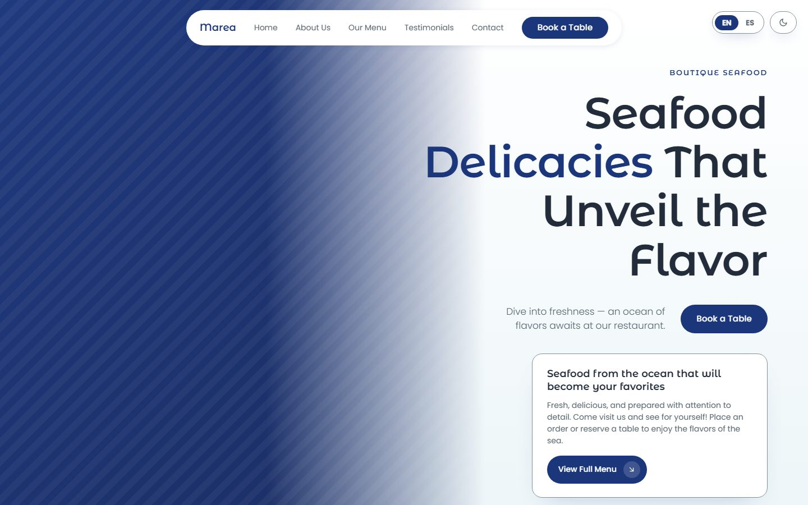
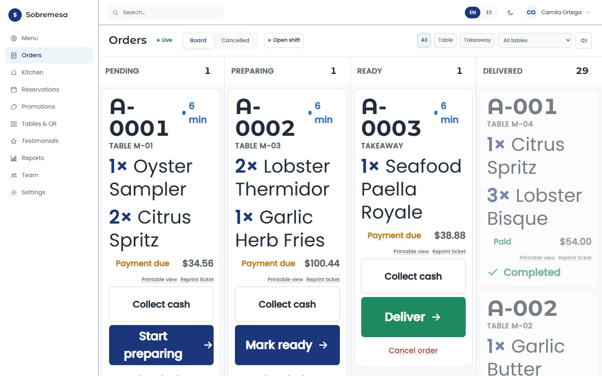
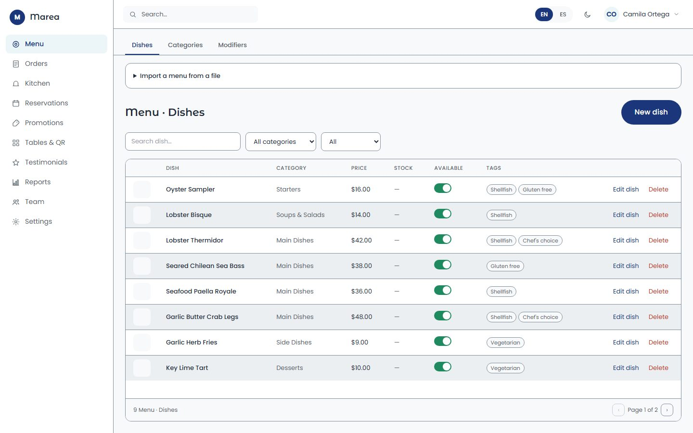
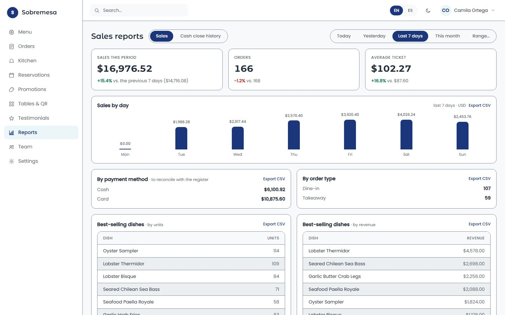
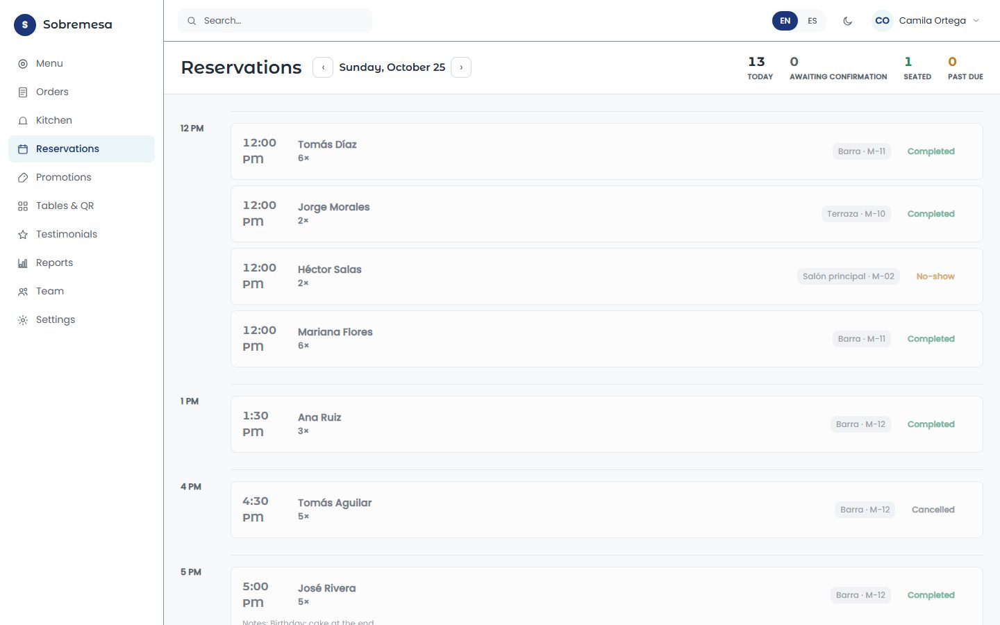
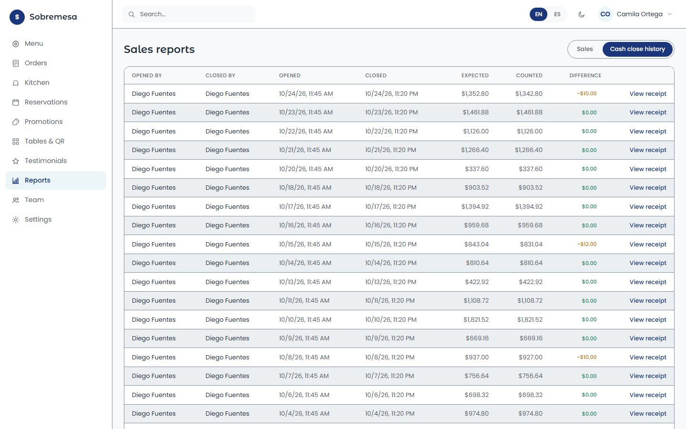
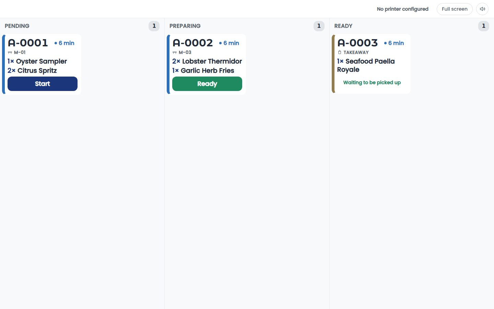
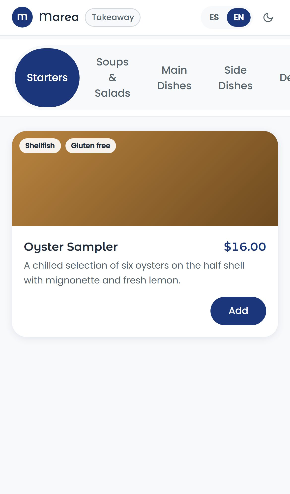
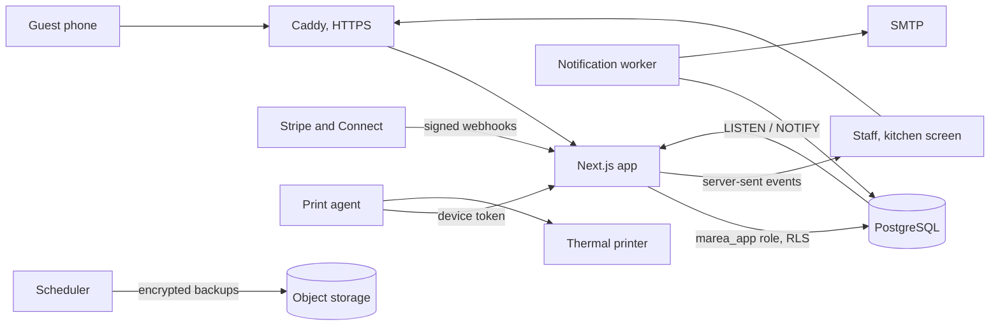

# Sobremesa — restaurant management system

[](https://github.com/filibertosanudo/marea-restaurant/actions/workflows/ci.yml)
[](https://github.com/filibertosanudo/marea-restaurant/actions/workflows/restore-test.yml)

A complete system to run a restaurant, or a small chain: the public website,
QR-code ordering at the table, reservations, card payments paid straight into the
restaurant's own Stripe account, a live order board and kitchen display, cash
register shifts, menu and stock management, and reports.

It is shown here through **Marea**, a fictional seafood restaurant built as the
sample client: its website was designed first, then the whole system behind it.
Each real client gets its own deployment, with its own website and brand on top of
the same system. The same code can also run as a multi-restaurant platform with
self-service signup and a monthly subscription, off by default.

Built by [Filiberto Sañudo](https://github.com/filibertosanudo) as a portfolio piece:
what can be built for a restaurant, end to end.

> **Live demo:** *link added once deployed.* Marea's website, and its panel: one
> click signs you in as the owner of its two branches, the manager, a waiter or
> the kitchen; everything resets every night.
>
> **En español:** ver el [resumen al final](#resumen-en-español).

<p align="center">
  
  
  
  
</p>

<details>
<summary>More screens</summary>
<p align="center">
  
  
  
  
</p>

The demo data is six weeks of generated orders, payments, cash shifts and
reservations (`prisma/seed-history.ts`), the same every night.
</details>

## What it does

**For guests**
- A website driven entirely by the restaurant's own data: menu, offers, reviews,
  hours, with per-page metadata, JSON-LD and a sitemap.
- Scan the QR code on the table, order from the phone, pay by card or at the counter,
  and follow the order live.
- Book a table; double bookings are impossible because the database refuses them.

**For staff**
- A live order board and a kitchen display that update in about 130 ms, with
  printed kitchen tickets through a small agent that drives a thermal printer.
- Cash register shifts with a frozen closing difference, refunds tied to the shift.
- Menu with modifiers, per-dish stock, promotions applied at checkout, review
  moderation, tables with printable QR sheets.

**For the owner**
- Sales reports compared against the previous period, exportable to CSV.
- Several branches under one account, each on its own subdomain, each paid into its
  own Stripe account (Stripe Connect, direct charges).
- Menu import from an Excel CSV, with a row-by-row preview before anything is written.

**Platform mode (optional)**

The same deployment can host many unrelated restaurants (`SIGNUP_ENABLED=1`):
- They sign up alone: email verification, a four-step setup wizard, sample data,
  a 14-day trial and a monthly subscription.
- If a payment lapses, nothing breaks at lunch: the panel warns, configuration
  freezes on day 7 while orders keep flowing, the site pauses on day 15, and every
  step only ever takes effect after the branch's closing time.

## Engineering highlights

The parts most worth a reviewer's time, each with the file that explains it.

- **Tenant isolation enforced by Postgres, not by discipline.** Every business table
  has a row level security policy. The app connects as a role that is neither the
  table owner nor a superuser (and refuses to boot in production as anything else),
  and each pooled connection is stamped with the request's business as it is handed
  out. A query that forgets its `where` sees nothing instead of everything.
  `lib/db/tenant-pool.ts`, `prisma/migrations/*_enable_row_level_security`.
- **Money paths that cannot double-apply.** A payment is marked paid only by Stripe's
  signed webhook, recorded in the same transaction as its effect, so a redelivery is
  a no-op. Every call names the connected account it acts on, and the raw Stripe
  client is unreachable outside one folder (enforced by ESLint).
  `lib/payments/stripe-webhook.ts`, `lib/stripe/payments.ts`.
- **Realtime without polling.** Postgres triggers `pg_notify` on every write that
  matters; one `LISTEN` connection per web process fans out to the screens over
  server-sent events, with a recovery sweep after reconnects. Five idle screens went
  from 605 database statements a minute to 2. `lib/realtime/`, `docs/perf-baseline.md`.
- **Writes guarded by construction.** A test walks every Server Action in the
  repository, not a hand-written list, and fails if one skips the role check, the
  maintenance read-only switch or the subscription's degrade step. It found actions
  a manual review had missed. `lib/ops/read-only-coverage.test.ts`.
- **Self-service signup without handing the web process the keys.** Creating a
  business is a narrow `SECURITY DEFINER` function that validates in the database;
  plan limits are checked with the organization row locked, so two requests cannot
  both take the last branch. `prisma/migrations/*_add_signup_primitive`,
  `lib/billing/branch-actions.ts`.
- **A business-hours-aware billing ladder.** The degrade step is computed from the
  subscription mirror and the branch's opening hours, never stored, so there is no
  job to forget. `lib/billing/degrade.ts`.
- **Operations taken seriously.** Encrypted backups every six hours to object storage
  with object lock, and a restore that is actually tested monthly in CI against a
  throwaway database. `docs/RUNBOOK.md`.

## Tests

1,600+ tests across 179 files, run on every pull request:

- **Integration tests against a real Postgres** (85 files): row level security is
  exercised as the application role, races are run as real concurrent transactions.
- **End-to-end tests** (Playwright) against the production Docker image, including a
  new restaurant going from signup to its first order.
- **Smoke tests against a Stripe sandbox**, including a test clock that runs a trial
  to its end.
- Coverage thresholds that fail the build, a pull-request size check, and a
  Lighthouse budget for the public site.

## Stack

Next.js 16 (App Router, Server Actions) · React 19 · TypeScript · Tailwind CSS ·
PostgreSQL 17 with row level security · Prisma 7 · Auth.js v5 · Stripe and Stripe
Connect · Vitest · Playwright · Docker Compose · Caddy



About 39,000 lines of TypeScript, 57 database models in 34 hand-reviewed migrations,
built over 120+ pull requests with a written plan (`docs/PLAN-PRODUCCION.md`) and one
reviewed phase at a time.

## Run it locally

With Docker, nothing else to install:

```bash
cp .env.example .env    # set POSTGRES_PASSWORD, APP_DB_PASSWORD, WORKER_DB_PASSWORD, AUTH_SECRET
docker compose up -d --build db migrate app worker
docker compose run --rm seed
```

Then open [http://marea.localhost:3000](http://marea.localhost:3000) (set
`BUSINESS_ROOT_DOMAIN=localhost` and `AUTH_URL=http://marea.localhost:3000` in
`.env`; browsers resolve `*.localhost` on their own). The seed creates two
fictional restaurants, Marea and Cala, in one chain; the admin panel is at
`/admin/login`. `PRODUCT_NAME` sets the system's name in the panel (each
restaurant's pages show its own), and `SIGNUP_ENABLED=1` opens platform mode.

<details>
<summary>Seeded accounts (local only)</summary>

| Email | Password | Role |
|---|---|---|
| `owner@marea.test` | `MareaOwner123!` | Owner of the chain (Marea and Cala) |
| `admin@marea.test` | `MareaAdmin123!` | Manager of Marea |
| `mesera@marea.test` | `MareaMesera123!` | Waiter at Marea |
| `admin@cala.test` | `CalaAdmin123!` | Manager of Cala |
| `super@marea.test` | `MareaSuper123!` | Platform admin |

These passwords are public: the seed refuses to run against a database that does
not look local.
</details>

Without Docker: Node 22+ and Postgres 17+, then `npm install`, `npm run db:migrate`,
`npm run db:seed` and `npm run dev`. `npm test` runs the suite (it needs a database).

## Documentation

| | |
|---|---|
| [`docs/DEPLOY.md`](docs/DEPLOY.md) | Deploying on a VPS, Stripe webhooks, the platform subscription, running the public demo |
| [`docs/RUNBOOK.md`](docs/RUNBOOK.md) | Operations: deploys and rollbacks, restoring from backup, read-only mode, stuck webhooks, rotating secrets |
| [`docs/DATABASE.md`](docs/DATABASE.md) | Why the schema looks the way it does |
| [`docs/design.md`](docs/design.md) | Design tokens; open [`docs/design.html`](docs/design.html) for the live style guide |
| [`AGENTS.md`](AGENTS.md) | The rules that are not obvious from the code |
| [`docs/PLAN-PRODUCCION.md`](docs/PLAN-PRODUCCION.md) | The production plan, phase by phase, with what was verified (Spanish) |

## Status

Feature-complete for a single restaurant or a small chain. Not built yet: Mexican
electronic invoicing (CFDI 4.0), two-factor authentication, WhatsApp and SMS
notifications, and an offline mode for waiters.

---

## Resumen en español

**Sobremesa** es un sistema completo para operar un restaurante o una cadena
pequeña: sitio web público, pedidos desde la mesa con código QR, reservaciones,
pagos con tarjeta que llegan directo a la cuenta de Stripe del restaurante, tablero
de pedidos y pantalla de cocina en tiempo real, corte de caja, menú, inventario y
reportes.

Se muestra a través de **Marea**, un restaurante de mariscos ficticio hecho como
cliente de ejemplo: primero se diseñó su sitio web y después todo el sistema detrás.
Cada cliente real recibe su propia instalación, con su sitio y su marca sobre el
mismo sistema. El mismo código también puede operar como plataforma de varios
restaurantes con registro propio y suscripción mensual, apagado por defecto.

**En la demo** ves el sitio de Marea y su panel: entras con un clic como dueño de
sus dos sucursales, como gerente, como mesero o como cocina, sin crear cuenta. Todo
se reinicia cada noche.

Lo que vale la pena revisar del código:

- **Aislamiento entre restaurantes en la base de datos**, con seguridad a nivel de
  fila de Postgres: una consulta que olvida filtrar no ve nada, en vez de ver todo.
- **Pagos que no se aplican dos veces:** solo el webhook firmado de Stripe marca un
  pago como cobrado, en la misma transacción que su efecto.
- **Tiempo real sin consultas repetidas:** las cinco pantallas en reposo pasaron de
  605 consultas por minuto a 2.
- **Una prueba que recorre todas las acciones del servidor** y falla si alguna no
  revisa permisos, el modo de mantenimiento o el estado de la suscripción.
- **En modo plataforma, un cobro de suscripción que nunca corta el servicio en hora
  de comida:** cada cambio entra al cierre de la sucursal, según su horario.
- **Más de 1,600 pruebas**, con integración contra un Postgres real, pruebas de
  extremo a extremo contra la imagen de Docker de producción y pruebas contra el
  sandbox de Stripe.

Hecho por [Filiberto Sañudo](https://github.com/filibertosanudo).
